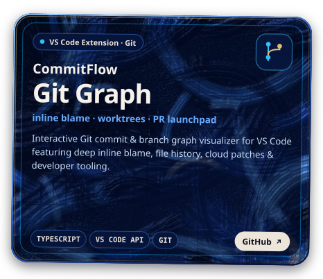
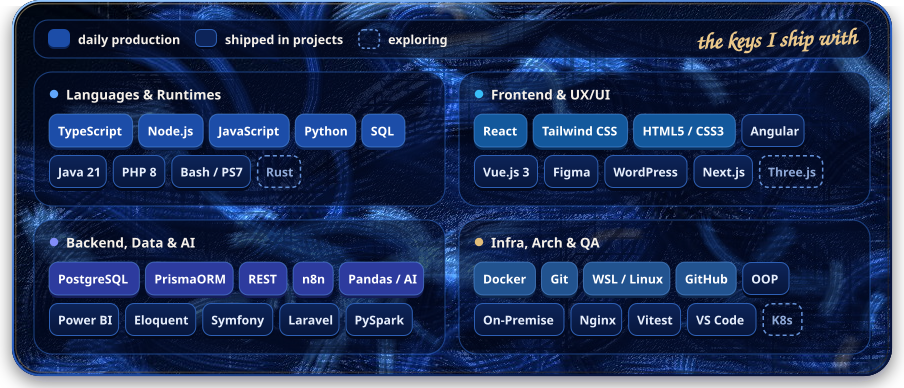
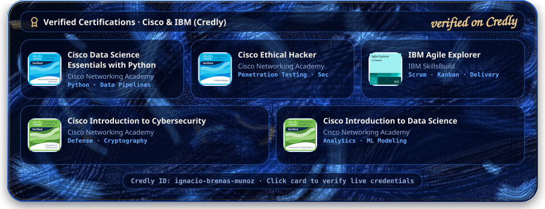

<!-- Generated by assets/gen_cards.py from assets/profile.json -->

<a href="https://ignaciobrenas.vercel.app">
<picture>
  <source media="(prefers-color-scheme: dark)" srcset="assets/cards/hero-dark.svg">
  <source media="(prefers-color-scheme: light)" srcset="assets/cards/hero-light.svg">
  
</picture>
</a>

  
  
  
  
  

<picture>
  <source media="(prefers-color-scheme: dark)" srcset="assets/cards/section-work-dark.svg">
  <source media="(prefers-color-scheme: light)" srcset="assets/cards/section-work-light.svg">
  
</picture>

<a href="https://github.com/Ignaciobrenas/DAMA-CRM">
<picture>
  <source media="(prefers-color-scheme: dark)" srcset="assets/cards/work-dama-crm-dark.svg">
  <source media="(prefers-color-scheme: light)" srcset="assets/cards/work-dama-crm-light.svg">
  
</picture>
</a>
<a href="https://github.com/Ignaciobrenas/CommitFlow">
<picture>
  <source media="(prefers-color-scheme: dark)" srcset="assets/cards/work-commit-flow-dark.svg">
  <source media="(prefers-color-scheme: light)" srcset="assets/cards/work-commit-flow-light.svg">
  
</picture>
</a>
 
<a href="https://github.com/Ignaciobrenas/SenseHue">
<picture>
  <source media="(prefers-color-scheme: dark)" srcset="assets/cards/work-sense-hue-dark.svg">
  <source media="(prefers-color-scheme: light)" srcset="assets/cards/work-sense-hue-light.svg">
  
</picture>
</a>
<a href="https://github.com/Ignaciobrenas/Virtual_Mouse">
<picture>
  <source media="(prefers-color-scheme: dark)" srcset="assets/cards/work-virtual-mouse-dark.svg">
  <source media="(prefers-color-scheme: light)" srcset="assets/cards/work-virtual-mouse-light.svg">
  
</picture>
</a>

<picture>
  <source media="(prefers-color-scheme: dark)" srcset="assets/cards/work-more-dark.svg">
  <source media="(prefers-color-scheme: light)" srcset="assets/cards/work-more-light.svg">
  
</picture>

  <a href="https://github.com/Ignaciobrenas/Nurse-Simulator"><b>Nurse-Simulator ↗</b></a> &nbsp;·&nbsp; <a href="https://github.com/Ignaciobrenas/Nurse-Simulator-Frontend"><b>Nurse-Simulator-Frontend ↗</b></a> &nbsp;·&nbsp; <a href="https://github.com/Ignaciobrenas/RunAndEat"><b>RunAndEat ↗</b></a> &nbsp;·&nbsp; <a href="https://github.com/Ignaciobrenas/Argus-Fraud-Radar"><b>Argus-Fraud-Radar ↗</b></a> &nbsp;·&nbsp; <a href="https://github.com/Ignaciobrenas/AirPop"><b>AirPop ↗</b></a> &nbsp;·&nbsp; <a href="https://github.com/Ignaciobrenas?tab=repositories"><b>Explore all 40+ repositories ↗</b></a>

<picture>
  <source media="(prefers-color-scheme: dark)" srcset="assets/cards/section-stack-dark.svg">
  <source media="(prefers-color-scheme: light)" srcset="assets/cards/section-stack-light.svg">
  
</picture>

<picture>
  <source media="(prefers-color-scheme: dark)" srcset="assets/cards/stack-dark.svg">
  <source media="(prefers-color-scheme: light)" srcset="assets/cards/stack-light.svg">
  
</picture>

<picture>
  <source media="(prefers-color-scheme: dark)" srcset="assets/cards/section-certifications-dark.svg">
  <source media="(prefers-color-scheme: light)" srcset="assets/cards/section-certifications-light.svg">
  
</picture>

<a href="https://www.credly.com/users/ignacio-brenas-munoz">
<picture>
  <source media="(prefers-color-scheme: dark)" srcset="assets/cards/certifications-dark.svg">
  <source media="(prefers-color-scheme: light)" srcset="assets/cards/certifications-light.svg">
  
</picture>
</a>

<picture>
  <source media="(prefers-color-scheme: dark)" srcset="assets/cards/section-activity-dark.svg">
  <source media="(prefers-color-scheme: light)" srcset="assets/cards/section-activity-light.svg">
  
</picture>

<picture>
  <source media="(prefers-color-scheme: dark)" srcset="https://raw.githubusercontent.com/Ignaciobrenas/ignaciobrenas/cards/summary-dark.svg">
  
</picture>
<picture>
  <source media="(prefers-color-scheme: dark)" srcset="https://raw.githubusercontent.com/Ignaciobrenas/ignaciobrenas/cards/about-dark.svg">
  
</picture>

<picture>
  <source media="(prefers-color-scheme: dark)" srcset="https://raw.githubusercontent.com/Ignaciobrenas/ignaciobrenas/cards/weekly-dark.svg">
  
</picture>
<picture>
  <source media="(prefers-color-scheme: dark)" srcset="https://raw.githubusercontent.com/Ignaciobrenas/ignaciobrenas/cards/languages-dark.svg">
  
</picture>

<picture>
  <source media="(prefers-color-scheme: dark)" srcset="assets/cards/section-contact-dark.svg">
  <source media="(prefers-color-scheme: light)" srcset="assets/cards/section-contact-light.svg">
  
</picture>

<a href="mailto:ignaciobrenas@gmail.com">
<picture>
  <source media="(prefers-color-scheme: dark)" srcset="assets/cards/contact-dark.svg">
  <source media="(prefers-color-scheme: light)" srcset="assets/cards/contact-light.svg">
  
</picture>
</a>

  Barcelona, Spain (On-site · Hybrid · Remote) · ES / CAT / EN · Generated by <a href="assets/gen_cards.py"><code>assets/gen_cards.py</code></a> &amp; <a href="cool-readme.yml"><code>github-cool-readme</code></a> · <a href="https://ignaciobrenas.vercel.app">ignaciobrenas.vercel.app</a>

