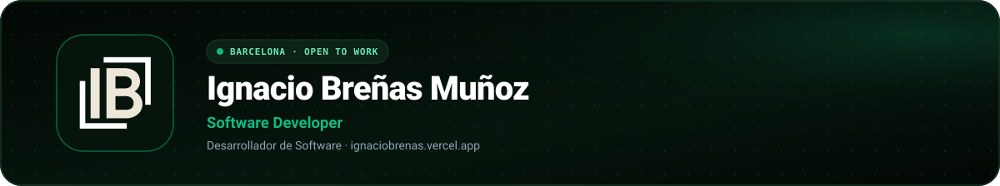
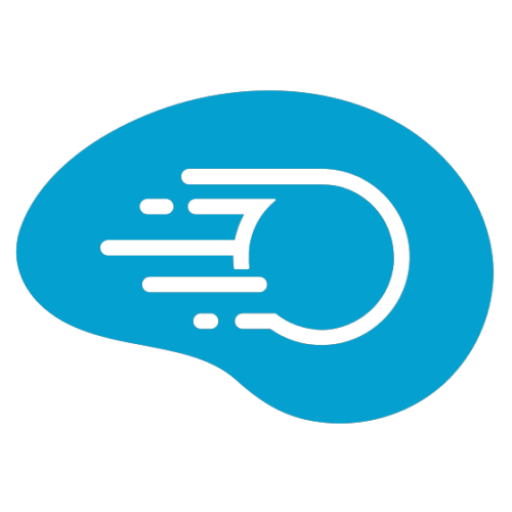
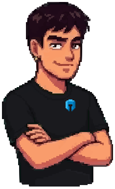
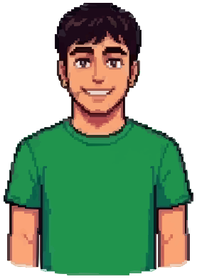
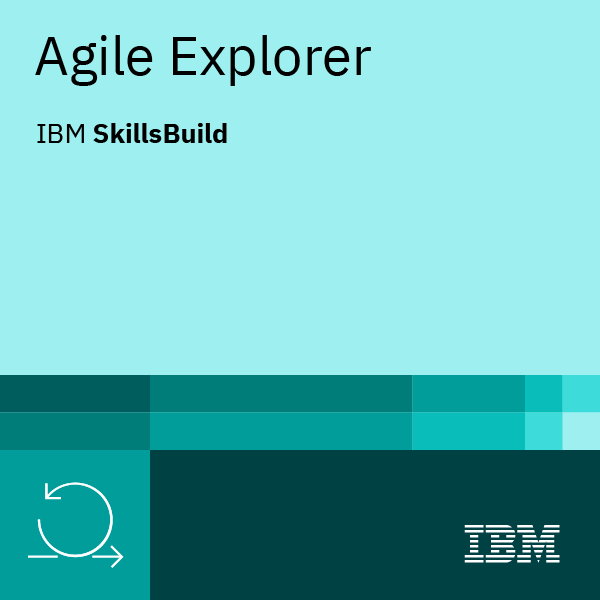
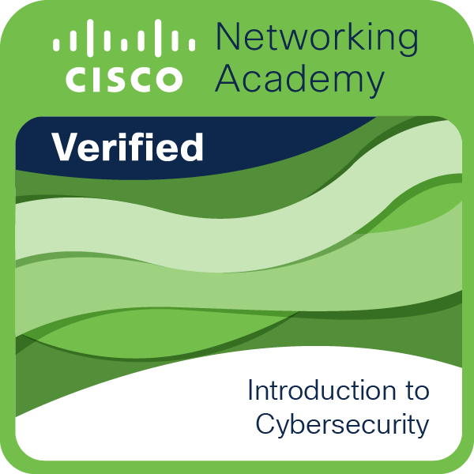
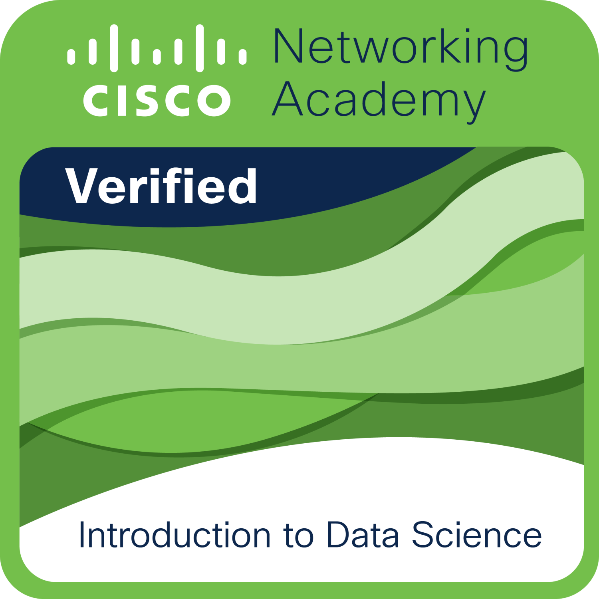
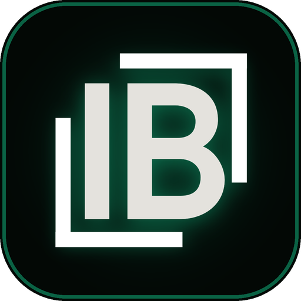
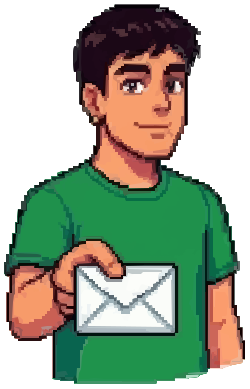
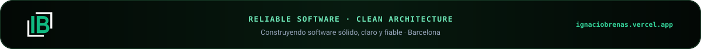

<div align="center">

<!-- Hero Banner (Dual Theme · Includes Brand Logo · No Company Name) -->
<a href="https://ignaciobrenas.vercel.app">
  <picture>
    <source media="(prefers-color-scheme: dark)" srcset="assets/banners/banner-dark.svg">
    <source media="(prefers-color-scheme: light)" srcset="assets/banners/banner-light.svg">
    
  </picture>
</a>

<!-- Typing Tagline (Green Brand Palette · Dual Theme) -->
<p align="center">
  <a href="https://ignaciobrenas.vercel.app">
    <picture>
      <source media="(prefers-color-scheme: dark)" srcset="https://readme-typing-svg.demolab.com?font=JetBrains+Mono&weight=700&size=17&duration=2600&pause=1100&color=10B981&center=true&vCenter=true&width=760&lines=Full+Stack+Software+Developer+%C2%B7+Barcelona;TypeScript+(Strict)+%C2%B7+React+%C2%B7+Node.js+%C2%B7+Python;Enterprise+Integrations+%C2%B7+Stoam+Connect+%26+n8n;PostgreSQL+%2B+PrismaORM+%2B+Docker+%2F+LXC;Model+Context+Protocol+(MCP)+%26+AI+Tooling;Open+to+Work+%C2%B7+Hybrid+%2F+Remote">
      <source media="(prefers-color-scheme: light)" srcset="https://readme-typing-svg.demolab.com?font=JetBrains+Mono&weight=700&size=17&duration=2600&pause=1100&color=059669&center=true&vCenter=true&width=760&lines=Full+Stack+Software+Developer+%C2%B7+Barcelona;TypeScript+(Strict)+%C2%B7+React+%C2%B7+Node.js+%C2%B7+Python;Enterprise+Integrations+%C2%B7+Stoam+Connect+%26+n8n;PostgreSQL+%2B+PrismaORM+%2B+Docker+%2F+LXC;Model+Context+Protocol+(MCP)+%26+AI+Tooling;Open+to+Work+%C2%B7+Hybrid+%2F+Remote">
      
    </picture>
  </a>
</p>

<!-- Brand Avatar & Rounded Action Pills (Single Row) -->
<p align="center">
  <a href="https://ignaciobrenas.vercel.app">
    
  </a>
</p>

<p align="center">
  <a href="https://ignaciobrenas.vercel.app">
    <picture>
      <source media="(prefers-color-scheme: dark)" srcset="assets/pills/btn-portfolio-dark.svg">
      <source media="(prefers-color-scheme: light)" srcset="assets/pills/btn-portfolio-light.svg">
      
    </picture>
  </a>
  &nbsp;
  <a href="https://www.linkedin.com/in/ignacio-bre%C3%B1as-mu%C3%B1oz-02a90b218/">
    <picture>
      <source media="(prefers-color-scheme: dark)" srcset="assets/pills/btn-linkedin-dark.svg">
      <source media="(prefers-color-scheme: light)" srcset="assets/pills/btn-linkedin-light.svg">
      
    </picture>
  </a>
  &nbsp;
  <a href="https://www.credly.com/users/ignacio-brenas-munoz">
    <picture>
      <source media="(prefers-color-scheme: dark)" srcset="assets/pills/btn-credly-dark.svg">
      <source media="(prefers-color-scheme: light)" srcset="assets/pills/btn-credly-light.svg">
      
    </picture>
  </a>
  &nbsp;
  <a href="mailto:ignaciobrenas@gmail.com">
    <picture>
      <source media="(prefers-color-scheme: dark)" srcset="assets/pills/btn-email-dark.svg">
      <source media="(prefers-color-scheme: light)" srcset="assets/pills/btn-email-light.svg">
      
    </picture>
  </a>
  &nbsp;
  <a href="https://ignaciobrenas.vercel.app/CV_IgnacioBre%C3%B1asMu%C3%B1oz.pdf">
    <picture>
      <source media="(prefers-color-scheme: dark)" srcset="assets/pills/btn-cv-dark.svg">
      <source media="(prefers-color-scheme: light)" srcset="assets/pills/btn-cv-light.svg">
      
    </picture>
  </a>
</p>

<!-- Rounded Identity Chips (Single Row) -->
<p align="center">
  <picture>
    <source media="(prefers-color-scheme: dark)" srcset="assets/pills/chip-role-dark.svg">
    <source media="(prefers-color-scheme: light)" srcset="assets/pills/chip-role-light.svg">
    
  </picture>
  &nbsp;
  <picture>
    <source media="(prefers-color-scheme: dark)" srcset="assets/pills/chip-edu-dark.svg">
    <source media="(prefers-color-scheme: light)" srcset="assets/pills/chip-edu-light.svg">
    
  </picture>
  &nbsp;
  <picture>
    <source media="(prefers-color-scheme: dark)" srcset="assets/pills/chip-loc-dark.svg">
    <source media="(prefers-color-scheme: light)" srcset="assets/pills/chip-loc-light.svg">
    
  </picture>
  &nbsp;
  <picture>
    <source media="(prefers-color-scheme: dark)" srcset="assets/pills/chip-avail-dark.svg">
    <source media="(prefers-color-scheme: light)" srcset="assets/pills/chip-avail-light.svg">
    
  </picture>
  &nbsp;
  <picture>
    <source media="(prefers-color-scheme: dark)" srcset="assets/pills/chip-lang-dark.svg">
    <source media="(prefers-color-scheme: light)" srcset="assets/pills/chip-lang-light.svg">
    
  </picture>
</p>

</div>

---

## <picture><source media="(prefers-color-scheme: dark)" srcset="assets/icons/user-check-dark.svg"><source media="(prefers-color-scheme: light)" srcset="assets/icons/user-check-light.svg"></picture> About Me
<sub>*Sobre mí — Desarrollador de Software  en Barcelona*</sub>

I am a ** Software Developer** based in Barcelona focused on building clean, reliable software that solves real operational problems. Currently completing my 2nd year of the **CFGS in Web Application Development (DAW)** at STUCOM Pelai—after graduating in **Microcomputer Systems and Networks (SMR)**—while working in production enterprise environments.

I enjoy owning features end to end: designing relational schemas in PostgreSQL, writing strict TypeScript (zero `any`), shipping automated test suites, connecting external ERPs, and talking directly with clients to turn messy requirements into working software.

**Core engineering focus** <sub>*(Enfoque técnico)*</sub>:
- ** & Strict TypeScript:** Type-safe backends and responsive interfaces with **TypeScript**, **Node.js**, **React**, **Tailwind CSS**, and **Python**.
- **Databases & Persistence:** Schema design, queries, and migrations in **PostgreSQL** (`PrismaORM`), MySQL, and SQLite.
- **Enterprise Integrations & Automation:** Connecting platforms and ERPs (**Sage**, **A3ERP**, **Odoo**) via REST APIs, webhooks, and **n8n** workflows.
- **AI Tooling & MCP:** Building deterministic **Model Context Protocol (MCP)** servers with OAuth 2.0 PKCE and Zod runtime validation.
- **Infrastructure & Quality:** Containerized deployments with **Docker** and **LXC** on Linux, automated testing (Vitest, Playwright), and Agile/Kanban delivery.

---

## <picture><source media="(prefers-color-scheme: dark)" srcset="assets/icons/briefcase-dark.svg"><source media="(prefers-color-scheme: light)" srcset="assets/icons/briefcase-light.svg"></picture> Work Experience
<sub>*Experiencia profesional*</sub>

<table>
<tr>
<td width="67%" valign="top">

<p>
  <a href="https://soterguard.com/">
    <picture>
      <source media="(prefers-color-scheme: dark)" srcset="assets/logos/soterguard-dark.png">
      <source media="(prefers-color-scheme: light)" srcset="assets/logos/soterguard.png">
      
    </picture>
  </a>
  &nbsp;&nbsp;&nbsp;
  <a href="https://ignaciobrenas.vercel.app#experience">
    
  </a>
</p>

### ** Developer Intern** — [Soterguard](https://soterguard.com/)
*May 2026 – Present · Barcelona, Spain (Hybrid)*<br/>
<sub>*Desarrollador  en prácticas · Participación activa en Stoam Connect, desarrollo y clientes*</sub>

- **Active participation in Stoam Connect:** Co-developing and maintaining **Stoam Connect** to keep B2B and B2C platforms synchronized in real time with ERPs (**Sage**, **A3ERP**, **Odoo**) through REST APIs, webhooks, and **n8n** automation pipelines.
- ** Development:** Shipping features across web and On-Premise software using **TypeScript**, **Node.js**, **React**, **Tailwind CSS**, and **Python**, backed by **PostgreSQL** (`PrismaORM`) and deployed in **Docker** and **LXC** containers under Agile/Kanban.
- **Clients & Production Support:** Working directly with SMB clients through technical calls, gathering requirements, troubleshooting live systems, and resolving production incidents.

</td>
<td width="33%" align="center" valign="middle">

<a href="https://ignaciobrenas.vercel.app#experience">
  
</a>

<div align="left">

```yaml
Stack:
  - TypeScript / Node.js
  - React / Tailwind CSS
  - Python / n8n
  - Stoam Connect
  - Sage · A3ERP · Odoo
  - PostgreSQL / Prisma
  - Docker / LXC
```

</div>

</td>
</tr>

<tr>
<td width="67%" valign="top">

<p>
  <picture>
    <source media="(prefers-color-scheme: dark)" srcset="assets/logos/vimtech.png">
    <source media="(prefers-color-scheme: light)" srcset="assets/logos/vimtech-dark.png">
    
  </picture>
</p>

### **IT Hardware & Systems Intern** — VimTech
*September 2024 – March 2025 · El Masnou, Barcelona*<br/>
<sub>*Técnico informático en prácticas · Especialización en hardware Apple, sistemas y diagnóstico*</sub>

- Hardware diagnostics, microelectronics repair, and maintenance specializing in **Apple devices** (Mac, iPhone, iPad).
- OS provisioning, recovery, and hardening across macOS, Windows, and Linux (Debian / Ubuntu) for individuals and local businesses.

</td>
<td width="33%" valign="top">

**Focus areas** <sub>*(Especialidad)*</sub>:
- `Apple Hardware & macOS`
- `Diagnostics & Repair`
- `Linux (Debian / Ubuntu)`
- `Local Networks`

</td>
</tr>

<tr>
<td width="67%" valign="top">

<p>
  
  &nbsp;<strong>AJMA El Masnou</strong>
</p>

### **IT Support & Web Developer (Volunteer)** — AJMA
*March 2023 – August 2025 · El Masnou, Barcelona*<br/>
<sub>*Soporte TI y desarrollo web (voluntariado) · Infraestructura web y retransmisiones en directo*</sub>

- Designed, built, and maintained the association's official website (`ajma.es`).
- Operated live audiovisual setups (professional cameras, audio mixing consoles, and streaming pipelines) for cultural events.

</td>
<td width="33%" valign="top">

**Focus areas** <sub>*(Áreas)*</sub>:
- `Web Development`
- `Live Streaming`
- `Audio / Video Systems`

</td>
</tr>
</table>

---

## <picture><source media="(prefers-color-scheme: dark)" srcset="assets/icons/graduation-cap-dark.svg"><source media="(prefers-color-scheme: light)" srcset="assets/icons/graduation-cap-light.svg"></picture> Education
<sub>*Formación académica*</sub>

<table>
<tr>
<td width="67%" valign="top">

<p>
  <picture>
    <source media="(prefers-color-scheme: dark)" srcset="assets/logos/stucom-dark.svg">
    <source media="(prefers-color-scheme: light)" srcset="assets/logos/stucom.svg">
    
  </picture>
</p>

- **Higher Vocational Degree in Web Application Development (CFGS DAW)** — *2nd Year · Graduating 2026*<br/>
  <sub>*CFGS en Desarrollo de Aplicaciones Web · Arquitectura , bases de datos, APIs REST y seguridad*</sub>
- **Vocational Degree in Microcomputer Systems and Networks (CFGM SMR)** — *Graduated*<br/>
  <sub>*CFGM en Sistemas Microinformáticos y Redes · Administración Linux/Windows, redes y virtualización*</sub>

</td>
<td width="33%" align="center" valign="middle">

<a href="https://ignaciobrenas.vercel.app">
  
</a>

</td>
</tr>
</table>

---

## <picture><source media="(prefers-color-scheme: dark)" srcset="assets/icons/folder-git-2-dark.svg"><source media="(prefers-color-scheme: light)" srcset="assets/icons/folder-git-2-light.svg"></picture> Featured Projects
<sub>*Proyectos destacados*</sub>

<table>
<tr>
<td width="50%" valign="top">

<p>
  <picture>
    <source media="(prefers-color-scheme: dark)" srcset="assets/logos/dama-logo.png">
    <source media="(prefers-color-scheme: light)" srcset="assets/logos/dama-logo-dark.png">
    
  </picture>
</p>

### **[DAMA-CRM — Modular SaaS & ERP](https://github.com/Ignaciobrenas/DAMA-CRM)**
<sub>*CRM y ERP modular self-hosted multi-tenant para PYMEs*</sub>

Self-hosted multi-tenant CRM & ERP built for SMBs with strict tenant isolation.
- **Stack:** `TypeScript (Strict)` · `Node.js` · `PostgreSQL` · `PrismaORM` · `Docker`
- **Highlights:** **116+ automated tests passing**, ISO 19005-1 (PDF/A-3b) cryptographically signed invoicing, bidirectional Apple (`webcal://`) and Google Calendar sync, drag-and-drop Kanban pipeline, 2FA OTP, RBAC, and 11-language support.

<div align="center">
  <a href="https://github.com/Ignaciobrenas/DAMA-CRM">
    <picture>
      <source media="(prefers-color-scheme: dark)" srcset="assets/pills/repo-dama-dark.svg">
      <source media="(prefers-color-scheme: light)" srcset="assets/pills/repo-dama-light.svg">
      
    </picture>
  </a>
</div>

</td>
<td width="50%" valign="top">

<p>
  <picture>
    <source media="(prefers-color-scheme: dark)" srcset="assets/icons/bot-dark.svg">
    <source media="(prefers-color-scheme: light)" srcset="assets/icons/bot-light.svg">
    
  </picture>
</p>

### **[Canva Connector — MCP Server](https://github.com/Ignaciobrenas/canva-connector)**
<sub>*Servidor Model Context Protocol (MCP) para agentes de IA*</sub>

**Model Context Protocol (MCP)** server enabling AI agents to work reliably with the Canva API.
- **Stack:** `TypeScript` · `MCP` · `Zod` · `OAuth 2.0 PKCE`
- **Highlights:** PKCE authentication flow, runtime parameter validation with Zod schemas, folder management, and deterministic design export workflows.

<div align="center">
  <a href="https://github.com/Ignaciobrenas/canva-connector">
    <picture>
      <source media="(prefers-color-scheme: dark)" srcset="assets/pills/repo-canva-dark.svg">
      <source media="(prefers-color-scheme: light)" srcset="assets/pills/repo-canva-light.svg">
      
    </picture>
  </a>
</div>

</td>
</tr>

<tr>
<td width="50%" valign="top">

### **[Argus-Fraud — Real-Time Fraud Detection](https://github.com/Ignaciobrenas/Argus-Fraud)**
<sub>*Pipeline distribuido de detección de fraude financiero*</sub>

Distributed ML pipeline processing large-scale financial transactions to flag anomalous behavior.
- **Stack:** `PySpark` · `Spark MLlib` · `Python 3` · `Docker`
- **Highlights:** Gradient Boosted Trees and Random Forest classifiers trained on millions of records with AUC-ROC evaluation and anomaly visualization.

<div align="center">
  <a href="https://github.com/Ignaciobrenas/Argus-Fraud">
    <picture>
      <source media="(prefers-color-scheme: dark)" srcset="assets/pills/repo-argus-dark.svg">
      <source media="(prefers-color-scheme: light)" srcset="assets/pills/repo-argus-light.svg">
      
    </picture>
  </a>
</div>

</td>
<td width="50%" valign="top">

### **[Run & Eat 2.0.0 — Culinary Platform](https://github.com/Ignaciobrenas/RunAndEat-2.0.0)**
<sub>*Plataforma web de reservas y rutas gastronómicas en Barcelona*</sub>

Interactive platform to discover and book culinary events and food routes around Barcelona.
- **Stack:** `Vue.js 3` · `TypeScript` · `Tailwind CSS` · `MySQL` · `Vite`
- **Highlights:** Real-time booking availability, interactive admin dashboard, and mobile-first responsive UI.

<div align="center">
  <a href="https://github.com/Ignaciobrenas/RunAndEat-2.0.0">
    <picture>
      <source media="(prefers-color-scheme: dark)" srcset="assets/pills/repo-runandeat-dark.svg">
      <source media="(prefers-color-scheme: light)" srcset="assets/pills/repo-runandeat-light.svg">
      
    </picture>
  </a>
</div>

</td>
</tr>

<tr>
<td width="50%" valign="top">

### **[Skeleton-Meme — Focus CV Guard](https://github.com/Ignaciobrenas/Skeleton-Meme)**
<sub>*Visión artificial para detectar distracciones con el móvil*</sub>

Computer vision utility that detects when you glance down at your phone during coding sessions.
- **Stack:** `Python 3` · `OpenCV` · `MediaPipe Face Mesh`
- **Highlights:** Real-time 468-landmark face mesh and iris tracking with automated audio/visual triggers.

<div align="center">
  <a href="https://github.com/Ignaciobrenas/Skeleton-Meme">
    <picture>
      <source media="(prefers-color-scheme: dark)" srcset="assets/pills/repo-skeleton-dark.svg">
      <source media="(prefers-color-scheme: light)" srcset="assets/pills/repo-skeleton-light.svg">
      
    </picture>
  </a>
</div>

</td>
<td width="50%" valign="top">

### **[Lugia Terminal Setup — Dev Environment](https://github.com/Ignaciobrenas/lugia-terminal-setup)**
<sub>*Configuración de terminal ergonómica y portable*</sub>

Portable terminal configuration for Windows Terminal, PowerShell 7, Neovim, and Zsh.
- **Stack:** `PowerShell 7` · `Neovim (Lua)` · `Oh-My-Posh` · `Git`
- **Highlights:** Reproducible dotfiles, ergonomic keyboard bindings, git status prompts, and high-contrast themes.

<div align="center">
  <a href="https://github.com/Ignaciobrenas/lugia-terminal-setup">
    <picture>
      <source media="(prefers-color-scheme: dark)" srcset="assets/pills/repo-terminal-dark.svg">
      <source media="(prefers-color-scheme: light)" srcset="assets/pills/repo-terminal-light.svg">
      
    </picture>
  </a>
</div>

</td>
</tr>
</table>

<div align="center">
  <em>Explore 30+ public repositories: <strong><a href="https://github.com/Ignaciobrenas?tab=repositories">github.com/Ignaciobrenas</a></strong></em><br/>
  <sub><em>Explora más de 30 repositorios públicos en GitHub</em></sub>
</div>

---

## <picture><source media="(prefers-color-scheme: dark)" srcset="assets/icons/layers-dark.svg"><source media="(prefers-color-scheme: light)" srcset="assets/icons/layers-light.svg"></picture> Tech Stack
<sub>*Stack tecnológico*</sub>

<div align="center">

#### Languages & Runtimes <sub>*(Lenguajes)*</sub>

<picture>
  <source media="(prefers-color-scheme: dark)" srcset="assets/stack/languages-dark.svg">
  <source media="(prefers-color-scheme: light)" srcset="assets/stack/languages-light.svg">
  
</picture>

#### Frontend & Web <sub>*(Desarrollo Web)*</sub>

<picture>
  <source media="(prefers-color-scheme: dark)" srcset="assets/stack/frontend-dark.svg">
  <source media="(prefers-color-scheme: light)" srcset="assets/stack/frontend-light.svg">
  
</picture>

#### Databases, ORMs & APIs <sub>*(Bases de Datos)*</sub>

<picture>
  <source media="(prefers-color-scheme: dark)" srcset="assets/stack/databases-dark.svg">
  <source media="(prefers-color-scheme: light)" srcset="assets/stack/databases-light.svg">
  
</picture>

#### DevOps, Systems & Tools <sub>*(Infraestructura)*</sub>

<picture>
  <source media="(prefers-color-scheme: dark)" srcset="assets/stack/devops-dark.svg">
  <source media="(prefers-color-scheme: light)" srcset="assets/stack/devops-light.svg">
  
</picture>

<p>
  <code>Stoam Connect</code> · <code>n8n Automation</code> · <code>Sage / A3ERP / Odoo</code> · <code>Model Context Protocol (MCP)</code> · <code>LXC Containers</code>
</p>

</div>

---

## <picture><source media="(prefers-color-scheme: dark)" srcset="assets/icons/award-dark.svg"><source media="(prefers-color-scheme: light)" srcset="assets/icons/award-light.svg"></picture> Verified Certifications
<sub>*Certificaciones oficiales verificadas en Credly*</sub>

<table>
  <tr>
    <th align="center">Badge</th>
    <th align="left">Certification</th>
    <th align="center">Issuer</th>
    <th align="center">Verification</th>
  </tr>
  <tr>
    <td align="center"></td>
    <td><strong>Cisco Data Science Essentials with Python</strong></td>
    <td align="center">Cisco Networking Academy</td>
    <td align="center"><a href="https://www.credly.com/users/ignacio-brenas-munoz">Verify on Credly ↗</a></td>
  </tr>
  <tr>
    <td align="center"></td>
    <td><strong>Cisco Ethical Hacker</strong></td>
    <td align="center">Cisco Networking Academy</td>
    <td align="center"><a href="https://www.credly.com/users/ignacio-brenas-munoz">Verify on Credly ↗</a></td>
  </tr>
  <tr>
    <td align="center"></td>
    <td><strong>IBM Agile Explorer</strong></td>
    <td align="center">IBM SkillsBuild</td>
    <td align="center"><a href="https://www.credly.com/users/ignacio-brenas-munoz">Verify on Credly ↗</a></td>
  </tr>
  <tr>
    <td align="center"></td>
    <td><strong>Cisco Introduction to Cybersecurity</strong></td>
    <td align="center">Cisco Networking Academy</td>
    <td align="center"><a href="https://www.credly.com/users/ignacio-brenas-munoz">Verify on Credly ↗</a></td>
  </tr>
  <tr>
    <td align="center"></td>
    <td><strong>Cisco Introduction to Data Science</strong></td>
    <td align="center">Cisco Networking Academy</td>
    <td align="center"><a href="https://www.credly.com/users/ignacio-brenas-munoz">Verify on Credly ↗</a></td>
  </tr>
</table>

<div align="center">
  <sub>Credly ID: <code>ignacio-brenas-munoz</code></sub>
</div>

---

## <picture><source media="(prefers-color-scheme: dark)" srcset="assets/icons/languages-dark.svg"><source media="(prefers-color-scheme: light)" srcset="assets/icons/languages-light.svg"></picture> Languages & Availability
<sub>*Idiomas y disponibilidad*</sub>

<table>
<tr>
<td width="50%" valign="top">

**Working Languages** <sub>*(Idiomas)*</sub>
- **Spanish:** Native *(Castellano nativo)*
- **English:** Professional proficiency (**B2 / C1**) — Technical documentation, RFCs, and international collaboration
- **Catalan:** Native *(Català natiu)*

</td>
<td width="50%" valign="top">

**Location & Mobility** <sub>*(Ubicación y disponibilidad)*</sub>
- **Location:** Barcelona, Spain *(Barcelona, España)*
- **Work Mode:** On-site (Barcelona area) · Hybrid · 100% Remote
- **Availability:** **Immediate / Open to Work** *(Disponibilidad inmediata)*

</td>
</tr>
</table>

---

## <picture><source media="(prefers-color-scheme: dark)" srcset="assets/icons/chart-bar-dark.svg"><source media="(prefers-color-scheme: light)" srcset="assets/icons/chart-bar-light.svg"></picture> GitHub Activity
<sub>*Estadísticas y actividad en GitHub*</sub>

<div align="center">


<p align="center">
  <a href="https://github.com/Ignaciobrenas">
    <picture>
      <source media="(prefers-color-scheme: dark)" srcset="https://github-readme-stats-fast.vercel.app/api?username=Ignaciobrenas&show_icons=true&include_all_commits=true&count_private=true&bg_color=030805&title_color=10b981&text_color=ede7da&icon_color=10b981&border_color=163623&border_radius=16&disable_animations=true&rank_icon=github">
      <source media="(prefers-color-scheme: light)" srcset="https://github-readme-stats-fast.vercel.app/api?username=Ignaciobrenas&show_icons=true&include_all_commits=true&count_private=true&bg_color=ffffff&title_color=059669&text_color=0f172a&icon_color=059669&border_color=cbd5e1&border_radius=16&disable_animations=true&rank_icon=github">
      
    </picture>
  </a>
  &nbsp;
  <a href="https://github.com/Ignaciobrenas">
    <picture>
      <source media="(prefers-color-scheme: dark)" srcset="https://github-readme-stats-fast.vercel.app/api/top-langs/?username=Ignaciobrenas&layout=compact&langs_count=8&bg_color=030805&title_color=10b981&text_color=ede7da&border_color=163623&border_radius=16&disable_animations=true">
      <source media="(prefers-color-scheme: light)" srcset="https://github-readme-stats-fast.vercel.app/api/top-langs/?username=Ignaciobrenas&layout=compact&langs_count=8&bg_color=ffffff&title_color=059669&text_color=0f172a&border_color=cbd5e1&border_radius=16&disable_animations=true">
      
    </picture>
  </a>
</p>

<p align="center">
  <a href="https://github.com/Ignaciobrenas">
    <picture>
      <source media="(prefers-color-scheme: dark)" srcset="https://github-readme-streak-stats.herokuapp.com/?user=Ignaciobrenas&background=030805&ring=10b981&fire=10b981&currStreakLabel=34d399&sideNums=34d399&currStreakNum=10b981&dates=94a3b8&sideLabels=10b981&border=163623&border_radius=16&disable_animations=true&mode=weekly">
      <source media="(prefers-color-scheme: light)" srcset="https://github-readme-streak-stats.herokuapp.com/?user=Ignaciobrenas&background=ffffff&ring=059669&fire=059669&currStreakLabel=059669&sideNums=059669&currStreakNum=059669&dates=475569&sideLabels=059669&border=cbd5e1&border_radius=16&disable_animations=true&mode=weekly">
      
    </picture>
  </a>
</p>

<p align="center">
  <a href="https://github.com/Ignaciobrenas">
    <picture>
      <source media="(prefers-color-scheme: dark)" srcset="https://github-readme-activity-graph.vercel.app/graph?username=Ignaciobrenas&bg_color=030805&color=10b981&line=10b981&point=ffffff&area=true&area_color=0a2416&hide_border=false&border_color=163623&title_color=34d399&radius=16&custom_title=GitHub%20Contribution%20Activity">
      <source media="(prefers-color-scheme: light)" srcset="https://github-readme-activity-graph.vercel.app/graph?username=Ignaciobrenas&bg_color=ffffff&color=059669&line=059669&point=059669&area=true&area_color=f0fdf4&hide_border=false&border_color=cbd5e1&title_color=059669&radius=16&custom_title=GitHub%20Contribution%20Activity">
      
    </picture>
  </a>
</p>

</div>

---

## <picture><source media="(prefers-color-scheme: dark)" srcset="assets/icons/send-dark.svg"><source media="(prefers-color-scheme: light)" srcset="assets/icons/send-light.svg"></picture> Get in Touch
<sub>*Contacto directo*</sub>

<div align="center">

<p>
  Open to software engineering roles, full-stack product teams, and technical integration projects.<br/>
  <sub><em>Abierto a oportunidades en ingeniería de software, equipos  y proyectos de integración técnica.</em></sub>
</p>

<p align="center">
  <a href="https://ignaciobrenas.vercel.app">
    <picture>
      <source media="(prefers-color-scheme: dark)" srcset="assets/brand/logo-dark.png">
      <source media="(prefers-color-scheme: light)" srcset="assets/brand/logo-light.png">
      
    </picture>
  </a>
  &nbsp;&nbsp;&nbsp;&nbsp;
  <a href="mailto:ignaciobrenas@gmail.com">
    
  </a>
</p>

<p align="center">
  <a href="https://ignaciobrenas.vercel.app">
    <picture>
      <source media="(prefers-color-scheme: dark)" srcset="assets/pills/btn-portfolio-dark.svg">
      <source media="(prefers-color-scheme: light)" srcset="assets/pills/btn-portfolio-light.svg">
      
    </picture>
  </a>
  &nbsp;
  <a href="https://www.linkedin.com/in/ignacio-bre%C3%B1as-mu%C3%B1oz-02a90b218/">
    <picture>
      <source media="(prefers-color-scheme: dark)" srcset="assets/pills/btn-linkedin-dark.svg">
      <source media="(prefers-color-scheme: light)" srcset="assets/pills/btn-linkedin-light.svg">
      
    </picture>
  </a>
  &nbsp;
  <a href="mailto:ignaciobrenas@gmail.com">
    <picture>
      <source media="(prefers-color-scheme: dark)" srcset="assets/pills/btn-email-dark.svg">
      <source media="(prefers-color-scheme: light)" srcset="assets/pills/btn-email-light.svg">
      
    </picture>
  </a>
  &nbsp;
  <a href="https://ignaciobrenas.vercel.app/CV_IgnacioBre%C3%B1asMu%C3%B1oz.pdf">
    <picture>
      <source media="(prefers-color-scheme: dark)" srcset="assets/pills/btn-cv-dark.svg">
      <source media="(prefers-color-scheme: light)" srcset="assets/pills/btn-cv-light.svg">
      
    </picture>
  </a>
</p>

<a href="https://ignaciobrenas.vercel.app">
  <picture>
    <source media="(prefers-color-scheme: dark)" srcset="assets/banners/footer-dark.svg">
    <source media="(prefers-color-scheme: light)" srcset="assets/banners/footer-light.svg">
    
  </picture>
</a>

</div>
