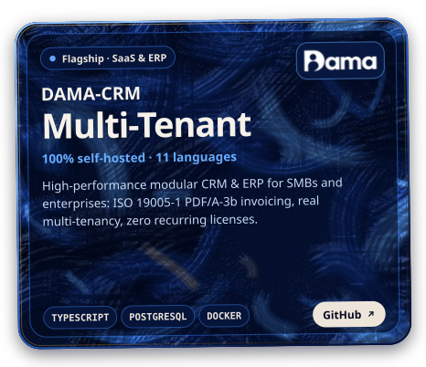
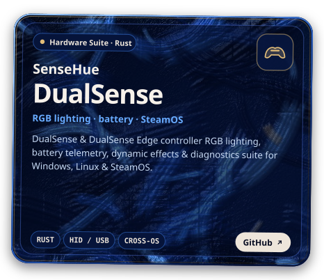
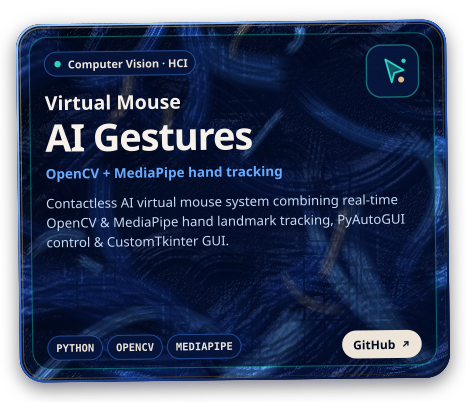
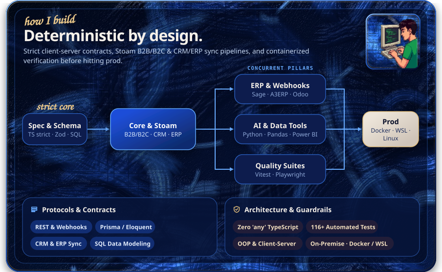
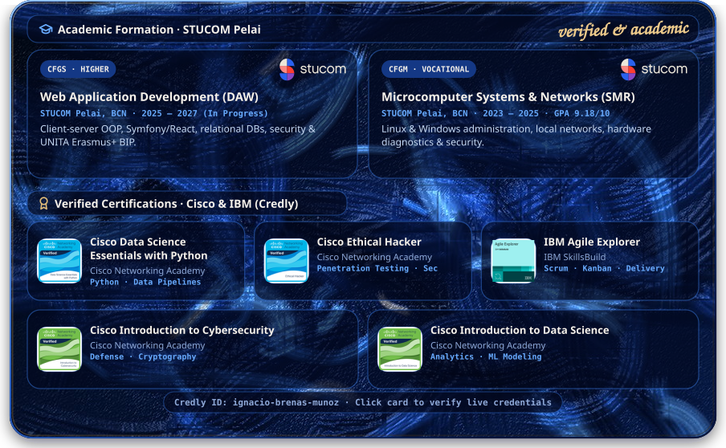
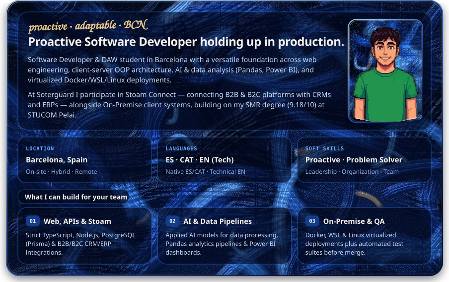
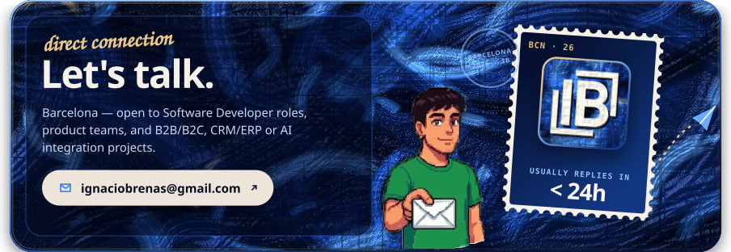

<!-- Generated by assets/gen_cards.py from assets/profile.json -->

<a href="https://ignaciobrenas.vercel.app">
<picture>
  <source media="(prefers-color-scheme: dark)" srcset="assets/cards/hero-dark.svg">
  <source media="(prefers-color-scheme: light)" srcset="assets/cards/hero-light.svg">
  
</picture>
</a>

  <a href="https://ignaciobrenas.vercel.app"><b>Portfolio</b></a>
  &nbsp;&nbsp;·&nbsp;&nbsp;
  <a href="https://github.com/Ignaciobrenas"><b>GitHub</b></a>
  &nbsp;&nbsp;·&nbsp;&nbsp;
  <a href="https://www.linkedin.com/in/ignacio-bre%C3%B1as-mu%C3%B1oz-02a90b218/"><b>LinkedIn</b></a>
  &nbsp;&nbsp;·&nbsp;&nbsp;
  <a href="https://www.credly.com/users/ignacio-brenas-munoz"><b>Credly</b></a>
  &nbsp;&nbsp;·&nbsp;&nbsp;
  <a href="mailto:ignaciobrenas@gmail.com"><b>ignaciobrenas@gmail.com</b></a>
  &nbsp;&nbsp;·&nbsp;&nbsp;
  <a href="https://ignaciobrenas.vercel.app/CV_IgnacioBre%C3%B1asMu%C3%B1oz.pdf"><b>Resume / CV</b></a>

<picture>
  <source media="(prefers-color-scheme: dark)" srcset="assets/cards/section-experience-dark.svg">
  <source media="(prefers-color-scheme: light)" srcset="assets/cards/section-experience-light.svg">
  
</picture>

<picture>
  <source media="(prefers-color-scheme: dark)" srcset="assets/cards/experience-dark.svg">
  <source media="(prefers-color-scheme: light)" srcset="assets/cards/experience-light.svg">
  
</picture>

<picture>
  <source media="(prefers-color-scheme: dark)" srcset="assets/cards/section-work-dark.svg">
  <source media="(prefers-color-scheme: light)" srcset="assets/cards/section-work-light.svg">
  
</picture>

<a href="https://github.com/Ignaciobrenas/DAMA-CRM">
<picture>
  <source media="(prefers-color-scheme: dark)" srcset="assets/cards/work-dama-crm-dark.svg">
  <source media="(prefers-color-scheme: light)" srcset="assets/cards/work-dama-crm-light.svg">
  
</picture>
</a>
<a href="https://github.com/Ignaciobrenas/CommitFlow">
<picture>
  <source media="(prefers-color-scheme: dark)" srcset="assets/cards/work-commit-flow-dark.svg">
  <source media="(prefers-color-scheme: light)" srcset="assets/cards/work-commit-flow-light.svg">
  
</picture>
</a>
 
<a href="https://github.com/Ignaciobrenas/SenseHue">
<picture>
  <source media="(prefers-color-scheme: dark)" srcset="assets/cards/work-sense-hue-dark.svg">
  <source media="(prefers-color-scheme: light)" srcset="assets/cards/work-sense-hue-light.svg">
  
</picture>
</a>
<a href="https://github.com/Ignaciobrenas/Virtual_Mouse">
<picture>
  <source media="(prefers-color-scheme: dark)" srcset="assets/cards/work-virtual-mouse-dark.svg">
  <source media="(prefers-color-scheme: light)" srcset="assets/cards/work-virtual-mouse-light.svg">
  
</picture>
</a>

<picture>
  <source media="(prefers-color-scheme: dark)" srcset="assets/cards/work-classroom-dark.svg">
  <source media="(prefers-color-scheme: light)" srcset="assets/cards/work-classroom-light.svg">
  
</picture>

  <a href="https://github.com/Ignaciobrenas/Nurse-Simulator"><b>Nurse-Simulator ↗</b></a> &nbsp;·&nbsp; <a href="https://github.com/Ignaciobrenas/Nurse-Simulator-Frontend"><b>Nurse-Simulator-Frontend ↗</b></a> &nbsp;·&nbsp; <a href="https://github.com/Ignaciobrenas/RunAndEat"><b>RunAndEat ↗</b></a> &nbsp;·&nbsp; <a href="https://github.com/Ignaciobrenas?tab=repositories"><b>Explore all 40+ repositories ↗</b></a>

<picture>
  <source media="(prefers-color-scheme: dark)" srcset="assets/cards/section-systems-dark.svg">
  <source media="(prefers-color-scheme: light)" srcset="assets/cards/section-systems-light.svg">
  
</picture>

<picture>
  <source media="(prefers-color-scheme: dark)" srcset="assets/cards/systems-dark.svg">
  <source media="(prefers-color-scheme: light)" srcset="assets/cards/systems-light.svg">
  
</picture>

<picture>
  <source media="(prefers-color-scheme: dark)" srcset="assets/cards/section-stack-dark.svg">
  <source media="(prefers-color-scheme: light)" srcset="assets/cards/section-stack-light.svg">
  
</picture>

<picture>
  <source media="(prefers-color-scheme: dark)" srcset="assets/cards/stack-dark.svg">
  <source media="(prefers-color-scheme: light)" srcset="assets/cards/stack-light.svg">
  
</picture>

<picture>
  <source media="(prefers-color-scheme: dark)" srcset="assets/cards/section-credentials-dark.svg">
  <source media="(prefers-color-scheme: light)" srcset="assets/cards/section-credentials-light.svg">
  
</picture>

<a href="https://www.credly.com/users/ignacio-brenas-munoz">
<picture>
  <source media="(prefers-color-scheme: dark)" srcset="assets/cards/credentials-dark.svg">
  <source media="(prefers-color-scheme: light)" srcset="assets/cards/credentials-light.svg">
  
</picture>
</a>

<picture>
  <source media="(prefers-color-scheme: dark)" srcset="assets/cards/section-about-dark.svg">
  <source media="(prefers-color-scheme: light)" srcset="assets/cards/section-about-light.svg">
  
</picture>

<picture>
  <source media="(prefers-color-scheme: dark)" srcset="assets/cards/about-dark.svg">
  <source media="(prefers-color-scheme: light)" srcset="assets/cards/about-light.svg">
  
</picture>

<picture>
  <source media="(prefers-color-scheme: dark)" srcset="assets/cards/section-activity-dark.svg">
  <source media="(prefers-color-scheme: light)" srcset="assets/cards/section-activity-light.svg">
  
</picture>

  

  <a href="https://github.com/Ignaciobrenas">
    <picture>
      <source media="(prefers-color-scheme: dark)" srcset="https://github-readme-stats-fast.vercel.app/api?username=Ignaciobrenas&show_icons=true&include_all_commits=true&count_private=true&bg_color=040c24&title_color=60a5fa&text_color=ebe4db&icon_color=3b82f6&border_color=1e3a8a&border_radius=18&disable_animations=true&rank_icon=github">
      <source media="(prefers-color-scheme: light)" srcset="https://github-readme-stats-fast.vercel.app/api?username=Ignaciobrenas&show_icons=true&include_all_commits=true&count_private=true&bg_color=f4f7fc&title_color=1d4ed8&text_color=06102f&icon_color=2563eb&border_color=bfdbfe&border_radius=18&disable_animations=true&rank_icon=github">
      
    </picture>
  </a>
  &nbsp;
  <a href="https://github.com/Ignaciobrenas">
    <picture>
      <source media="(prefers-color-scheme: dark)" srcset="https://github-readme-stats-fast.vercel.app/api/top-langs/?username=Ignaciobrenas&layout=compact&langs_count=8&bg_color=040c24&title_color=60a5fa&text_color=ebe4db&border_color=1e3a8a&border_radius=18&disable_animations=true">
      <source media="(prefers-color-scheme: light)" srcset="https://github-readme-stats-fast.vercel.app/api/top-langs/?username=Ignaciobrenas&layout=compact&langs_count=8&bg_color=f4f7fc&title_color=1d4ed8&text_color=06102f&border_color=bfdbfe&border_radius=18&disable_animations=true">
      
    </picture>
  </a>

  <a href="https://github.com/Ignaciobrenas">
    <picture>
      <source media="(prefers-color-scheme: dark)" srcset="https://github-readme-streak-stats.herokuapp.com/?user=Ignaciobrenas&background=040c24&ring=3b82f6&fire=e2bd79&currStreakLabel=60a5fa&sideNums=93c5fd&currStreakNum=ebe4db&dates=8aa5d4&sideLabels=60a5fa&border=1e3a8a&border_radius=18&disable_animations=true&mode=weekly">
      <source media="(prefers-color-scheme: light)" srcset="https://github-readme-streak-stats.herokuapp.com/?user=Ignaciobrenas&background=f4f7fc&ring=1d4ed8&fire=c89b54&currStreakLabel=1d4ed8&sideNums=1e40af&currStreakNum=06102f&dates=4b6496&sideLabels=1d4ed8&border=bfdbfe&border_radius=18&disable_animations=true&mode=weekly">
      
    </picture>
  </a>

  <a href="https://github.com/Ignaciobrenas">
    <picture>
      <source media="(prefers-color-scheme: dark)" srcset="https://github-readme-activity-graph.vercel.app/graph?username=Ignaciobrenas&bg_color=040c24&color=60a5fa&line=3b82f6&point=e2bd79&area=true&area_color=0c2459&hide_border=false&border_color=1e3a8a&title_color=ebe4db&radius=18&custom_title=GitHub%20Contribution%20Activity">
      <source media="(prefers-color-scheme: light)" srcset="https://github-readme-activity-graph.vercel.app/graph?username=Ignaciobrenas&bg_color=f4f7fc&color=1d4ed8&line=2563eb&point=c89b54&area=true&area_color=dbeafe&hide_border=false&border_color=bfdbfe&title_color=06102f&radius=18&custom_title=GitHub%20Contribution%20Activity">
      
    </picture>
  </a>

<picture>
  <source media="(prefers-color-scheme: dark)" srcset="assets/cards/section-contact-dark.svg">
  <source media="(prefers-color-scheme: light)" srcset="assets/cards/section-contact-light.svg">
  
</picture>

<a href="mailto:ignaciobrenas@gmail.com">
<picture>
  <source media="(prefers-color-scheme: dark)" srcset="assets/cards/contact-dark.svg">
  <source media="(prefers-color-scheme: light)" srcset="assets/cards/contact-light.svg">
  
</picture>
</a>

  Oil-canvas dual-theme profile cards generated by <a href="assets/gen_cards.py"><code>assets/gen_cards.py</code></a> from <a href="assets/profile.json"><code>assets/profile.json</code></a> · <a href="https://ignaciobrenas.vercel.app">ignaciobrenas.vercel.app</a>

