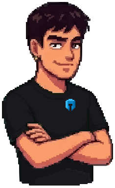
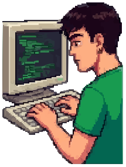

<!-- Hero Banner -->

<!-- Brand Logo & 32-Bit Pixel Art Avatar -->

  
  &nbsp;&nbsp;&nbsp;&nbsp;
  

<!-- Interactive Typing Tagline without unicode emojis -->

  

<!-- Core Action Badges using clean SimpleIcons -->

  
  
  
  
  

<!-- Identity Chips using clean tags -->

  
  
  
  
  

---

<!-- LANGUAGE ANCHOR BAR -->

|  [**Versión en Español ↓**](#sobre-mí) |  [**English Version ↓**](#about-me) |
|:---:|:---:|

---

##  Sobre Mí

> **Desarrollador de Software en Barcelona.** Con un perfil curioso, proactivo y resolutivo, enfoco mi trabajo en crear software sólido, fiable y de alto impacto. Me apasiona transformar problemas complejos en soluciones claras, aprender continuamente y aportar valor en cada proyecto.

Cuento con un perfil versátil que me permite aportar en el **desarrollo web full stack**, la **gestión y analítica de datos** y el **despliegue de infraestructuras virtualizadas**. Actualmente curso el 2º año del **CFGS en Desarrollo de Aplicaciones Web (DAW)** en STUCOM Pelai —tras graduarme en el **CFGM de Sistemas Microinformáticos y Redes (SMR)**— y me desempeño como **Software Developer Intern en Soterguard**.

En **Soterguard** participo en todas las etapas del ciclo de vida de aplicaciones **On-Premise** empresariales, además de trabajar en **Stoam**, automatizaciones avanzadas con **n8n**, e integraciones complejas con ERPs como **Sage, A3ERP y Odoo**, resolviendo incidencias críticas para PYMEs bajo metodologías **Agile / Kanban** y atención directa a clientes para comprender sus necesidades técnicas.

###  Pilares Técnicos Principales:
- **Desarrollo Full Stack & Tipado Estricto:** Código limpio en **TypeScript** (cero `any`), **Node.js**, **React**, **Tailwind CSS** y **Python**.
- **Bases de Datos & Persistencia:** Modelado conceptual y relacional optimizado en **PostgreSQL**, **PrismaORM**, SQL, MySQL y SQLite.
- **Integración de IA & Protocolo MCP:** Creación de herramientas deterministas y servidores **Model Context Protocol (MCP)** para agentes autónomos de IA.
- **Virtualización, Automatización & DevOps:** Entornos contenerizados en **Docker**, contenedores **LXC**, flujos automatizados en **n8n**, Linux y metodologías CI/CD.
- **Testing & Calidad de Código:** Suites completas con tests automatizados (Vitest, Playwright), arquitectura modular y despliegue continuo.

---

##  About Me

> **Software Developer based in Barcelona, Spain.** Curious, proactive, and solution-driven, I craft robust, reliable, and high-impact digital solutions. I am passionate about turning complex technical requirements into intuitive systems, continuously learning, and delivering genuine value in every project.

I bring a versatile background spanning **full-stack web development**, **data management**, and **containerized infrastructure**. Currently completing my 2nd year of the **Higher Vocational Degree (CFGS) in Web Applications Development (DAW)** at STUCOM Pelai —having previously graduated in **Microcomputer Systems and Networks (SMR)**— while working as a **Software Developer Intern at Soterguard**.

At **Soterguard**, I contribute across all stages of enterprise **On-Premise applications**, developing for **Stoam**, orchestrating workflow automations in **n8n**, integrating core ERP platforms (**Sage, A3ERP, Odoo**), and troubleshooting client-facing technical incidents under **Agile / Kanban** workflows.

---

##  Experiencia Profesional / Work Experience

<table>
<tr>
<td width="65%" valign="top">

###  **Full Stack Developer Intern** | **[Soterguard](https://soterguard.com/)**
*Mayo 2026 – Actualidad · Barcelona / Híbrido*

- Participación integral en todas las fases de desarrollo y despliegue de **aplicaciones On-Premise** empresariales.
- Desarrollo en **Stoam**, **TypeScript**, **Node.js**, **React**, **Tailwind CSS** y **Python**.
- Orquestación de flujos y pipelines de automatización de procesos mediante **n8n**.
- Integraciones complejas con sistemas de gestión empresarial y ERPs: **Sage**, **A3ERP** y **Odoo**.
- Metodología **Agile** (tableros Kanban), iteraciones continuas y soporte directo con clientes para resolver incidencias técnicas y levantar requerimientos.

</td>
<td width="35%" align="center" valign="middle">

 
<b style="color: #10b981;">Full Stack Dev @ Soterguard</b>
  

  <code>TypeScript</code> · <code>Node.js</code> 
  <code>React</code> · <code>Tailwind CSS</code> 
  <code>Python</code> · <code>PostgreSQL</code> 
  <code>n8n</code> · <code>Docker / LXC</code> 
  <code>Sage / A3ERP / Odoo</code> 
  <code>Agile Kanban</code>

</td>
</tr>

<tr>
<td width="65%" valign="top">

###  **Técnico Informático en Prácticas** | **VimTech**
*Septiembre 2024 – Marzo 2025 · El Masnou, Barcelona*

- Diagnóstico, reparación de hardware y microelectrónica con alta especialización en **dispositivos Apple** (Mac, iPhone, iPad).
- Despliegue y configuración de sistemas operativos macOS, Windows y distribuciones Linux.
- Soporte técnico resolutivo presencial para particulares y PYMEs.

</td>
<td width="35%" valign="top">

**Especialidad:**
- `Hardware Apple / macOS`
- `Diagnóstico & Reparación`
- `Redes & Sistemas`

</td>
</tr>

<tr>
<td width="65%" valign="top">

###  **Soporte TI & Desarrollo Web (Voluntariado)** | **AJMA El Masnou**
*Marzo 2023 – Agosto 2025 · El Masnou, Barcelona*

- Diseño, desarrollo y mantenimiento continuo del portal web oficial de la asociación.
- Asistencia técnica audiovisual (cámara, sonido y mesas de control) y mantenimiento preventivo de equipos.

</td>
<td width="35%" valign="top">

**Áreas:**
- `Desarrollo Web`
- `Sistemas & Redes`
- `Producción Audiovisual`

</td>
</tr>
</table>

---

##  Proyectos Destacados / Featured Projects

<table>
<tr>
<td width="50%" valign="top">

### **[DAMA-CRM — SaaS & ERP Modular](https://github.com/Ignaciobrenas/DAMA-CRM)**

  

CRM y ERP modular self-hosted para PYMEs con aislamiento multi-tenant real.
- **Tecnologías:** `TypeScript (100% Estricto)` · `Node.js` · `PostgreSQL` · `PrismaORM` · `Docker`
- **Hitos:** Más de **116 tests automatizados pasando**, facturación legal ISO 19005-1 (PDF/A-3b con firma criptográfica), sincronización bidireccional Apple Calendar (`webcal://`) y Google Calendar, pipeline de ventas Kanban drag & drop, 2FA OTP, RBAC y soporte multi-idioma (11 idiomas).

</td>
<td width="50%" valign="top">

### **[Canva Connector — Servidor MCP para IA](https://github.com/Ignaciobrenas/canva-connector)**

  

Servidor oficial bajo el protocolo **Model Context Protocol (MCP)** para dotar a agentes autónomos de IA de capacidades completas sobre la API de Canva.
- **Tecnologías:** `TypeScript` · `Model Context Protocol` · `Zod` · `OAuth 2.0 PKCE`
- **Hitos:** Conexión segura con PKCE, validación en tiempo de ejecución de esquemas de parámetros con Zod y exportación determinista de diseños.

</td>
</tr>

<tr>
<td width="50%" valign="top">

### **[Argus-Fraud — Detección de Fraude en Tiempo Real](https://github.com/Ignaciobrenas/Argus-Fraud)**

  

Pipeline distribuido de Machine Learning y procesamiento masivo de transacciones financieras para detección y alerta temprana de fraude.
- **Tecnologías:** `PySpark` · `Apache Spark MLlib` · `Python 3` · `Docker`
- **Hitos:** Clasificación con árboles de decisión (Gradients / Random Forest) sobre millones de registros, métricas AUC-ROC y visualización de anomalías.

</td>
<td width="50%" valign="top">

### **[Run & Eat 2.0.0 — Plataforma Gastronómica](https://github.com/Ignaciobrenas/RunAndEat-2.0.0)**

  

Plataforma interactiva para descubrir y reservar veladas gastronómicas y rutas culinarias en el área de Barcelona.
- **Tecnologías:** `Vue.js 3` · `TypeScript` · `Tailwind CSS` · `MySQL` · `Vite`
- **Hitos:** Sistema de reservas reactivo, panel de administración interactivo y UI optimizada para dispositivos móviles.

</td>
</tr>

<tr>
<td width="50%" valign="top">

### **[Skeleton-Meme — Visión Artificial Anti-Procrastinación](https://github.com/Ignaciobrenas/Skeleton-Meme)**

  

Herramienta de productividad visual que detecta cuando el desarrollador desvía la mirada hacia el móvil durante el trabajo.
- **Tecnologías:** `Python 3` · `OpenCV` · `MediaPipe Face Mesh`
- **Hitos:** Detección de 468 puntos faciales y seguimiento del iris en tiempo real con disparadores de alertas multimedia.

</td>
<td width="50%" valign="top">

### **[Lugia Terminal Setup — Dev Environment](https://github.com/Ignaciobrenas/lugia-terminal-setup)**

  

Entorno de terminal de máxima eficiencia para Windows Terminal, PowerShell 7, Neovim y Zsh.
- **Tecnologías:** `PowerShell` · `Neovim (Lua)` · `Oh-My-Posh` · `Git`
- **Hitos:** Configuración portable, bindings ergonómicos de teclado, integraciones con git y temas optimizados de alto contraste.

</td>
</tr>
</table>

  <em>Explora más de 30 repositorios públicos en mi perfil: <strong><a href="https://github.com/Ignaciobrenas?tab=repositories">github.com/Ignaciobrenas/repositories</a></strong></em>

---

##  Stack Tecnológico

### Lenguajes & Runtimes

### Frontend & Ecosistema Web

### Bases de Datos, ORMs & Servicios

### Virtualización, Infraestructura & DevOps

---

##  Certificaciones Oficiales Verificadas en Credly

| Insignia | Entidad Emisora | Verificación Oficial |
| :--- | :---: | :---: |
| **Cisco Ethical Hacker** | Cisco Networking Academy | [Verificar en Credly ↗](https://www.credly.com/users/ignacio-brenas-munoz) |
| **IBM Agile Explorer** | IBM SkillsBuild | [Verificar en Credly ↗](https://www.credly.com/users/ignacio-brenas-munoz) |
| **Cisco Introduction to Cybersecurity** | Cisco Networking Academy | [Verificar en Credly ↗](https://www.credly.com/users/ignacio-brenas-munoz) |
| **Cisco Introduction to Data Science** | Cisco Networking Academy | [Verificar en Credly ↗](https://www.credly.com/users/ignacio-brenas-munoz) |

*Credly ID: `ignacio-brenas-munoz` · Verificación criptográfica oficial en tiempo real.*

---

##  Competencia Lingüística & Movilidad

<table>
<tr>
<td width="50%" valign="top">

### Idiomas de Trabajo
- **Castellano:** Nativo (lengua materna)
- **English:** Nivel Profesional (**B2 / C1**) — Fluidez en especificaciones técnicas, comunicación internacional, RFCs y trabajo en equipo
- **Català:** Nativo (educación íntegra en Cataluña)

</td>
<td width="50%" valign="top">

### Ubicación & Disponibilidad
- **Ubicación:** Barcelona, España
- **Modalidad:** Presencial en área de Barcelona · Híbrido · 100% Remoto
- **Disponibilidad:** **Inmediata / Open to Work**
- **Movilidad:** Transporte público regular por Barcelona · Preparando carnet de conducir B

</td>
</tr>
</table>

---

##  Estadísticas & Actividad en GitHub

<!-- Contador de visitas oficial -->

<!-- Tarjetas de estadísticas de GitHub -->

  
  &nbsp;
  

<!-- Tarjeta de racha continua -->

  

<!-- Gráfico interactivo de actividad de contribuciones -->

  

---

##  Contacto Directo

> *Siempre abierto a colaborar en proyectos tecnológicos exigentes, puestos de ingeniería de software e integraciones de alto rendimiento.*

  
  
  
  

  

**"Construyendo software sólido, eficiente y de alto impacto."**

